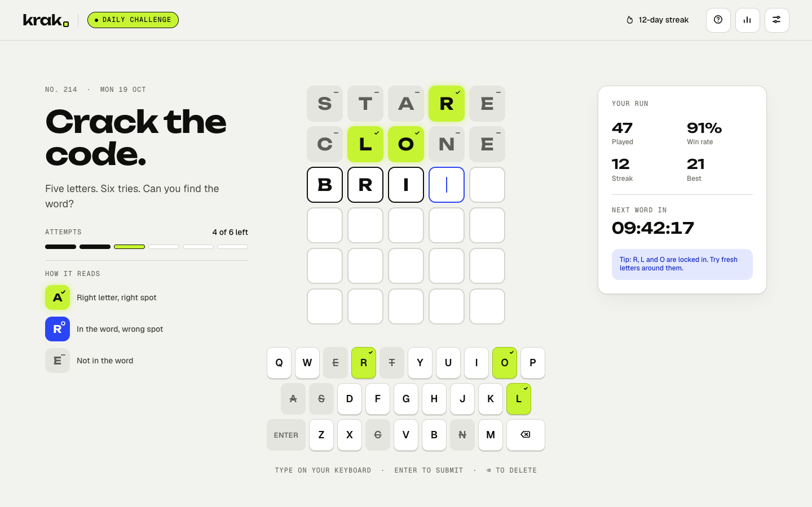
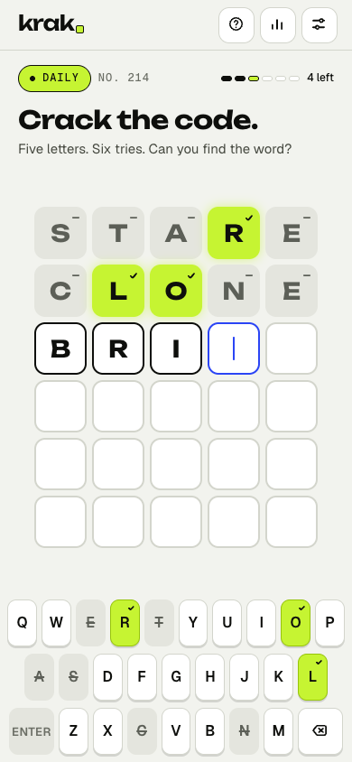
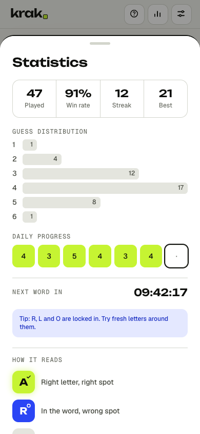
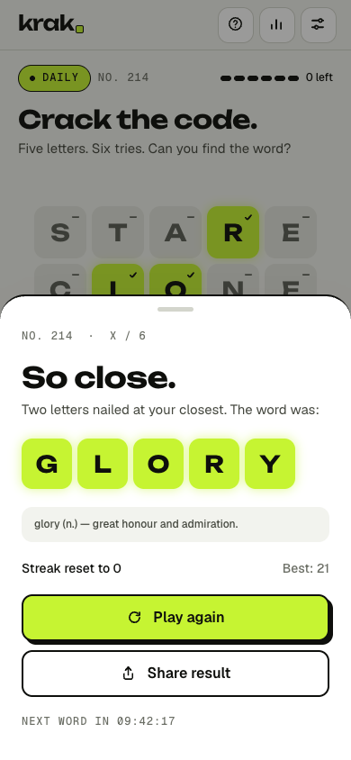
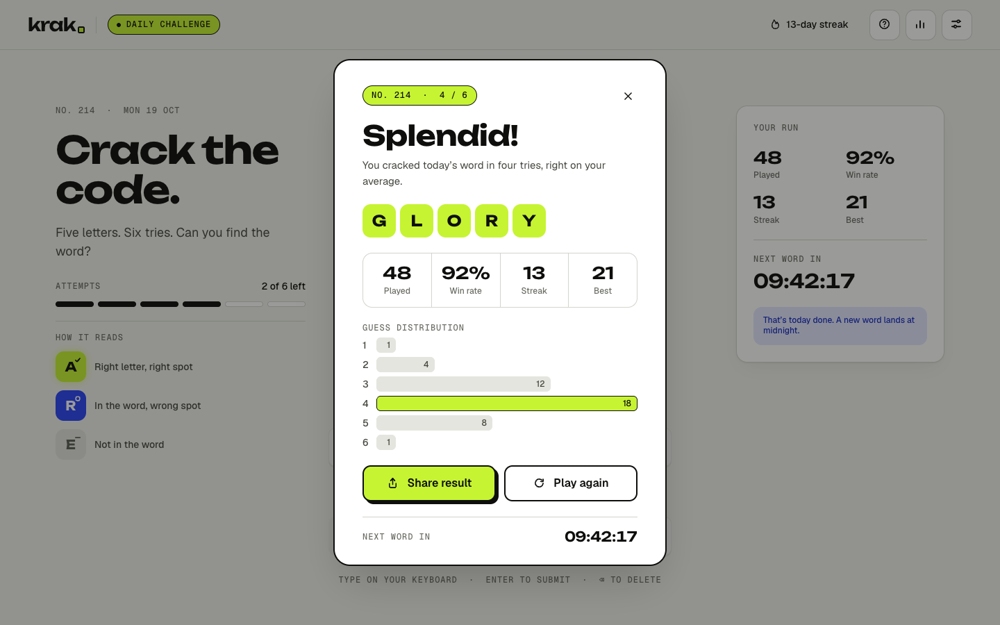

# 01 · krak.

> Build 01 of [40 Builds](../README.md): a design engineering build-in-public challenge.

## What it is

**krak.** is a daily five-letter word puzzle. Five letters, six tries, and the same word for everyone each day. It's a faithful implementation of a Figma design: foundations, components, desktop and mobile screens, and a written motion and accessibility spec.



## Design decisions

- **Figma is the source of truth.** Colours, type styles, radii and elevation are mirrored from the Figma variables in [`src/styles/tokens.css`](src/styles/tokens.css). Icons and status marks are the original Figma SVG exports.
- **Unbounded, Geist and Geist Mono.** Unbounded gives the wordmark and tiles their chunky, game-like presence; Geist handles UI; Geist Mono labels meta information.
- **Never colour alone.** Every tile status has a corner mark (✓ / ○ / –) and absent keys are struck through, so the board reads in greyscale and for all colour-vision types. The marks use the Figma SVGs as CSS masks so high-contrast mode can recolour them.
- **Every press answers.** Tiles pop, keys drop into their 2px lip, and physical and on-screen keyboards share one pressed state.
- **The signature interaction is the reveal.** Each tile flips on its X axis over 450ms with a 250ms stagger. The fill swaps while the tile is edge-on, the corner mark wipes in after landing, and keys recolour 100ms after the last tile lands.

### Decisions the design left open

- **"Play again" on a one-a-day game.** Figma shows a Play again button, but the daily word can't be replayed. It starts an unranked practice round with a different word: stats and the daily save are untouched, and a refresh returns to the daily.
- **How to Play, Settings and the Statistics sheet** have no Figma frames, so they're composed from the design system's modal, tile, button and type styles. The How to Play example reuses the STARE → CRANK → CRACK figure from the cover.
- **Result card:** also not in Figma. It sits in the Statistics sheet and uses colours and marks only, so a screenshot can't spoil the word.
- **Dark theme:** the design defines one light theme plus high contrast, so there is no dark mode.

## Technical highlights

- **Vite + React 18 + TypeScript (strict)**, Tailwind CSS v4 and Framer Motion. No GSAP or state library.
- **Logic is separate from presentation.** `src/game/` holds evaluation, daily selection, stats, sharing, storage and copy as plain TypeScript; `useGame` connects them to React.
- **Repeated letters done properly.** Two passes: exact matches claim their letter first, then remaining letters are matched left to right, so a letter is never marked more times than it appears.
- **Deterministic daily word.** The puzzle number comes from the calendar date (immune to daylight saving) and indexes a fixed-seed shuffle of 367 curated answers. No word repeats until the pool runs out. No. 214 is Mon 19 Oct 2026, as in the Figma file.
- **Local dictionary:** about 12,650 five-letter words, generated from the MIT-licensed `an-array-of-english-words`, with no runtime dependency.
- **Refresh-proof.** Guesses are saved at submission, before the animation, so refreshing mid-reveal can't undo a guess or replay the day. Recording a result is idempotent, so a puzzle can't be counted twice.
- **Sizing from the spec.** Tiles use CSS `min()` formulas from the responsive table, also capped by viewport height, so board and keyboard fit short phones without clipping.
- **Accessibility:**
  - The board is a grid with row labels ("Guess 2 of 6: R, wrong spot; O, not in word…").
  - One polite live region carries reveals and toasts.
  - Modals trap focus, close on Esc and restore focus to what opened them.
  - The tab order follows the spec, with a 3px cobalt focus ring.
  - The device's reduced-motion setting swaps flips, shakes and hops for 150ms crossfades. A Settings toggle can override it in either direction.

## Live demo

_Coming soon._

## Screenshots

| Mobile mid-game | Statistics sheet | Game over |
| --- | --- | --- |
|  |  |  |



## Run locally

```bash
npm install
npm run dev
```

```bash
npm test
```

```bash
npm run build
```

`npm test` runs the game-logic tests with Node's built-in test runner (Node 22.18+ for TypeScript support).

## Deploy

KRAK deploys with the rest of the challenge: the root `npm run build` serves it at `/01-word-puzzle/`.
